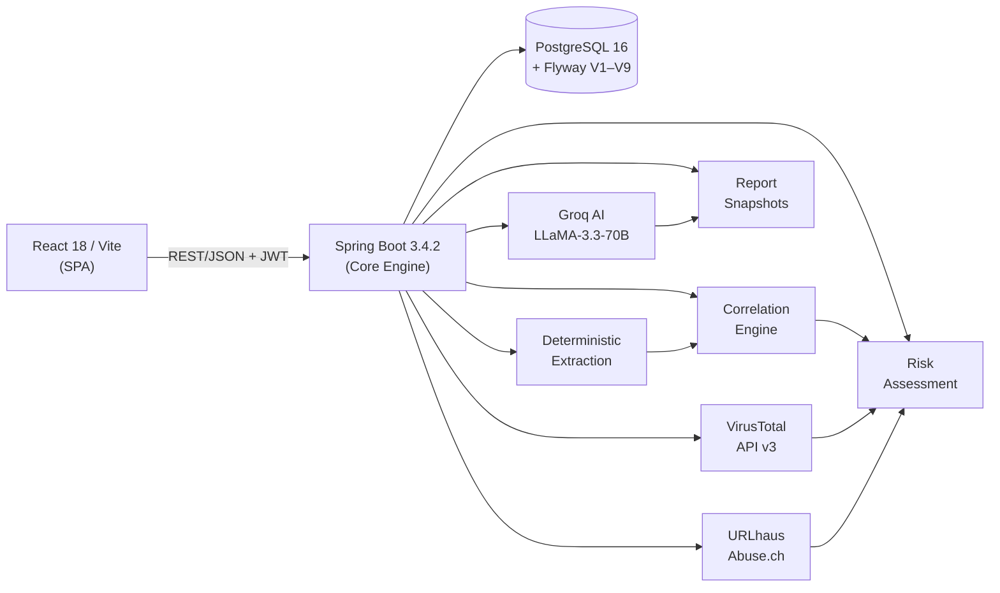

# PhantomTrace

> **Investigate entire scam campaigns — not just individual URLs.**

[](https://www.oracle.com/java/)
[](https://spring.io/projects/spring-boot)
[](https://react.dev/)
[](https://vitejs.dev/)
[](https://www.postgresql.org/)
[](LICENSE)

---

## Problem Statement

Modern social-engineering attacks are **fragmented by design**. A victim receives a suspicious SMS, clicks a redirect URL, opens a spoofed email, and scans a payment QR — each piece of evidence exists in a different channel. Existing tools (VirusTotal, URLhaus, free link scanners) examine each artifact **in isolation**. They answer "is this URL bad?" but cannot answer "are these three separate messages part of the same campaign?"

Investigators and security-aware individuals have no accessible tool to:
- Connect fragmented evidence into a coherent case dossier
- Distinguish **verified facts** from **AI hypotheses** from **unknowns**
- Reconstruct the campaign as a relationship graph rather than a checklist

---

## Solution

**PhantomTrace** is an AI-assisted forensic investigation platform that connects suspicious messages, URLs, emails, documents, and screenshots into a single explainable case. It:

1. **Ingests** multiple types of evidence in one investigation workspace
2. **Extracts** indicators deterministically (regex-first, no LLM required for extraction)
3. **Queries** live threat intelligence (VirusTotal, URLhaus) with explicit unavailability handling
4. **Runs** multi-agent AI forensic analysis via Groq (LLaMA-3.3-70B), labelling results `AI_INFERENCE`
5. **Correlates** evidence into a typed relationship graph (`SHARES_INDICATOR`, `CONTAINS_URL`, etc.)
6. **Scores** risk transparently using configurable heuristic weights (0–100 scale)
7. **Generates** printable investigation reports for audit or escalation

---

## Why PhantomTrace is Different

| Dimension | Traditional tools | PhantomTrace |
|---|---|---|
| **Scope** | One URL / one file at a time | Entire campaign in one investigation |
| **Epistemic honesty** | Binary clean/malicious labels | `VERIFIED` / `AI_INFERENCE` / `UNKNOWN` on every finding |
| **Evidence model** | Stateless scan | Persistent case with provenance graph |
| **AI role** | Chat assistant or black box | Structured agents with JSON outputs, labelled as inference |
| **Campaign reconstruction** | Not supported | Relationship graph links shared indicators across evidence |
| **Transparency** | Score with no explanation | Each risk signal listed with its weight and source |

---

## Key Features

🔍 **Multi-Format Evidence Ingestion** — Text messages, URLs, emails, PDFs, images (PNG/JPG/WEBP) in one case workspace. MIME validation, 25 MB limit, duplicate detection.

📋 **Deterministic Indicator Extraction** — RFC-compliant URLs, domains, IPv4s, emails, phone numbers, payment cues (UPI, wire, gift cards), urgency phrases — extracted with regex, no LLM dependency.

🌐 **Live Threat Intelligence** — VirusTotal v3 (URL-safe Base64 encoding, engine stats) and URLhaus/Abuse.ch integration with 1-hour database cache. Unavailable providers shown as unavailable, never as clean.

🤖 **Multi-Agent AI Forensic Reasoning** — Six specialized Groq agents (Text, URL, Email, File, Correlation, Report Detective) share one provider configuration. Outputs are structured JSON labelled `AI_INFERENCE`.

📊 **Interactive Evidence Relationship Graph** — React Flow canvas with typed nodes (Evidence, URL, Domain, Email, IP) and semantic edges. Minimap, zoom/pan, node detail sidebar, provenance trails, and campaign reconstruction.

📈 **Explainable Risk Assessment** — Configurable heuristic weights: Verified Malicious +40, Credential Request +25, Payment Demand +20, Impersonation +15, Urgency +10, Unusual URL +10. Score ≠ probability; confidence tracked separately.

📄 **Forensic Reports & PDF Export** — Immutable report snapshots: executive summary, forensic timeline, extracted artifacts, threat proof links, remediation steps. Browser Print → Save as PDF.

---

## Architecture



---

## Technology Stack

| Layer | Technology |
|---|---|
| **Frontend** | React 18, Vite 6, Tailwind CSS 3, React Router v6, Axios |
| **Visualization** | @xyflow/react (React Flow), Recharts, Lucide React |
| **Backend** | Spring Boot 3.4.2, Java 21, Spring Security 6, Spring Data JPA |
| **AI** | Groq API (LLaMA-3.3-70B-versatile) via OpenAI-compatible endpoint |
| **Database** | PostgreSQL 16, Flyway migrations (V1–V9), Hibernate |
| **Document/Media** | Apache PDFBox 3.0.4, ZXing 3.5.3, Tess4J 5.13.0 |
| **Auth** | JJWT 0.12.6 — HS256 JWT, bcrypt passwords |
| **Testing** | Vitest + @testing-library/react (frontend); JUnit 5 + Mockito (backend) |
| **Container** | Docker, docker-compose |

---

## Screenshots

> Screenshots are not committed yet; visual verification remains a manual release step.

---

## Installation

### Prerequisites

- **Node.js** v20+
- **Java** 21+ (JDK)
- **Maven** 3.9+
- **Docker** & Docker Compose

### Step-by-Step

**1. Clone the repository**
```bash
git clone https://github.com/samir-0-4/ScamShield.git phantomtrace
cd phantomtrace
```

**2. Copy environment templates**
```bash
cp .env.example .env
cp backend/.env.example backend/.env
cp frontend/.env.example frontend/.env
```

**3. Edit `backend/.env`** — fill in your secrets (see [Configuration](#configuration) below).

---

## Configuration

### Environment Variables

| Variable | Required | Description | Example |
|---|:---:|---|---|
| `POSTGRES_DB` | ✅ | Database name | `phantomtrace` |
| `POSTGRES_USER` | ✅ | DB username | `phantomtrace_user` |
| `POSTGRES_PASSWORD` | ✅ | DB password | *(generate)* |
| `DATABASE_URL` | ✅ | JDBC connection URL | `jdbc:postgresql://localhost:5432/phantomtrace` |
| `JWT_SECRET` | ✅ | HS256 signing key (≥32 bytes base64) | `openssl rand -base64 32` |
| `JWT_EXPIRATION_MS` | — | Token lifetime in ms | `86400000` (24h) |
| `GROQ_API_KEY` | ⚠️ | Groq API key — AI features degrade gracefully without it | `gsk_...` |
| `GROQ_DEFAULT_MODEL` | — | Groq model name | `llama-3.3-70b-versatile` |
| `VIRUSTOTAL_API_KEY` | ⚠️ | VirusTotal v3 key — threat intel degrades gracefully | `...` |
| `URLHAUS_API_KEY` | ⚠️ | URLhaus key | `...` |
| `FILE_STORAGE_TYPE` | — | `local` (default) | `local` |
| `FILE_STORAGE_UPLOAD_DIR` | — | Upload directory | `./uploads` |
| `VITE_API_BASE_URL` | ✅ | Backend API base URL (frontend) | `http://localhost:8080/api/v1` |

> [!IMPORTANT]
> `GROQ_API_KEY`, `VIRUSTOTAL_API_KEY`, and `URLHAUS_API_KEY` are **optional**. When absent, the platform shows explicit "unavailable" states — it does **not** pretend services are clean.

> [!CAUTION]
> Never commit `.env` files. The pre-commit hook at `.kiro/hooks/pre-commit-check.sh` checks for staged `.env` files and blocks the commit.

---

## Local Development

### 1. Start PostgreSQL (Docker)

```bash
docker compose up -d postgres
```

Verify:
```bash
docker compose ps
```

### 2. Start the Backend

```bash
cd backend
mvn spring-boot:run
```

Backend starts on `http://localhost:8080`. Flyway automatically applies migrations V1–V9.

Health check:
```bash
curl http://localhost:8080/api/v1/health
# {"status":"UP","application":"PhantomTrace"}
```

Campaign reconstruction:
```bash
curl -H "Authorization: Bearer $TOKEN" \
  http://localhost:8080/api/v1/investigations/<investigation-id>/campaign
```

### 3. Start the Frontend

```bash
cd frontend
npm install
npm run dev
```

Open `http://localhost:5173`.

---

## Database Setup

Flyway runs automatically on backend startup. Migrations are located in `backend/src/main/resources/db/migration/`:

| Migration | Description |
|---|---|
| V1 | Users and authentication |
| V2 | Investigations |
| V3 | Evidence items |
| V4 | Extracted indicators |
| V5 | Threat lookups |
| V6 | AI agent executions |
| V7 | Correlation / relationship graph |
| V8 | Risk assessments |
| V9 | Investigation reports |

No manual schema setup is required.

---

## Testing

### Frontend

```bash
cd frontend
npm test          # Run Vitest suite (vitest run)
npm run lint      # ESLint
npm run build     # Production build validation
```

### Backend

```bash
cd backend
mvn clean test    # JUnit 5 + Mockito suite
```

### Full Suite

```bash
./scripts/verify-all.sh
```

---

## Deployment

### Docker Compose (All Services)

```bash
docker compose up --build
```

This starts PostgreSQL and can be extended with backend/frontend service definitions.

### Individual Docker Builds

```bash
# Backend
cd backend
docker build -t phantomtrace-backend .

# Frontend
cd frontend
docker build -t phantomtrace-frontend .
```

> [!NOTE]
> File storage defaults to local volume (`./uploads`). For production, replace with S3-compatible object storage.

---

## Security Considerations

| Area | Implementation |
|---|---|
| **SSRF Protection** | Uploaded URLs are never fetched by the backend server. External lookups go only to whitelisted APIs (VirusTotal, URLhaus, Groq). |
| **File Validation** | MIME type check, 25 MB size limit, signature validation. Uploaded files are never executed. |
| **JWT Auth** | HS256, minimum 256-bit key enforced at startup. Known placeholder/weak keys rejected. |
| **API Key Isolation** | `GROQ_API_KEY`, `VIRUSTOTAL_API_KEY`, `URLHAUS_API_KEY` are backend-only. Never exposed to frontend or logs. |
| **SQL Injection** | Parameterized queries via Spring Data JPA/Hibernate. No raw SQL string concatenation. |
| **IDOR Prevention** | Every endpoint validates resource ownership against the authenticated user's ID. |
| **CORS** | Locked to configured frontend origin. |
| **Rate Limiting** | Bucket4j limits registration, login, investigation, and evidence requests per client IP. |
| **Secret Scanning** | Pre-commit hook blocks `.env` file commits. |

---

## Limitations

These are honest limitations of the current implementation:

- **OCR accuracy**: Tess4J OCR works best on clean, high-contrast images. Low-resolution screenshots may produce garbled text; this is acknowledged in the UI.
- **AI_INFERENCE not verified**: All Groq AI outputs are labelled `AI_INFERENCE`. PhantomTrace does not cross-verify AI claims against external databases.
- **No cloud metadata lookups**: The system does not query WHOIS, RDAP, ASN, or geolocation APIs. Domain age and registrar information are not available.
- **Groq rate limits**: Free-tier Groq accounts have token-per-minute limits. High-volume analysis may hit these; the system shows explicit error states, not silently degraded results.
- **Local storage only**: File uploads use local disk. Not suitable for horizontally scaled production without migrating to object storage.
- **QR decoding pipeline**: ZXing is integrated for QR extraction from images, but the end-to-end image → QR → analysis pipeline is not fully surfaced in the UI demo flow.
- **Risk score ≠ fraud probability**: The heuristic risk score is a weighted sum of signals, not a calibrated probability. It is explicitly not suitable as sole evidence of fraud.

---

## Kiro Development Workflow

This project was built using **[Kiro IDE](https://kiro.dev)** as the primary AI-assisted development environment. The `.kiro/` directory contains durable evidence of this workflow:

### Steering Documents (`.kiro/steering/`)

- **`project-rules.md`** — Core system invariants enforced across all Kiro sessions:
  - **Epistemic Truth Principle**: Every data point must be classified `VERIFIED`, `AI_INFERENCE`, or `UNKNOWN`. This rule directly shaped how AI outputs are stored and labelled in the database.
  - **Architecture Boundaries**: Controllers stay thin; business logic lives in services; external APIs are isolated in `integration/` modules.
  - **Safety Rule**: API keys must never appear in frontend code or logs.
- **`architecture.md`** — Full system architecture description for Kiro context injection.
- **`tech-stack.md`** — Canonical technology versions referenced during code generation.
- **`security.md`** — Security constraints enforced during feature development.
- **`coding-standards.md`** — Naming conventions, component structure, and patterns.
- **`testing.md`** — Test coverage requirements and test runner commands.

### Feature Specifications (`.kiro/specs/`)

Each major feature was developed as a Kiro spec with `requirements.md`, `design.md`, and `tasks.md`:

| Spec | Feature Driven |
|---|---|
| `frontend-foundation` | React app scaffold, routing, auth context, Tailwind dark theme |
| `auth-foundation` | JWT registration/login, Spring Security config |
| `backend-foundation` | Spring Boot project, Flyway V1 migration, health endpoint |
| `evidence-submission` | Multi-format evidence upload API + UI |
| `deterministic-evidence-extraction` | Regex extraction service, indicator normalization |
| `threat-intelligence-integration` | VirusTotal v3 + URLhaus clients, caching |
| `ai-analysis-agents` | Six Groq agents, shared provider, structured JSON responses |
| `evidence-correlation` | Correlation orchestrator, graph node/edge generation |
| `evidence-relationship-graph` | React Flow visualization, semantic edge rendering |
| `risk-assessment` | Heuristic risk engine, configurable weights |
| `investigation-results` | Results dashboard, threat feed display |
| `investigation-reports` | Report compilation, print-to-PDF layout |
| `hackathon-final-delivery` | End-to-end demo, verification, documentation |

### Hooks (`.kiro/hooks/`)

- **`pre-commit-check.sh`** — Verifies no `.env` files are staged in Git before allowing a commit.
- **`frontend-lint-build.sh`** — Runs ESLint and Vite build check.
- **`backend-test.sh`** — Runs backend unit tests.
- **`secret-scan.sh`** — Scans staged files for accidentally hardcoded secrets.

### Custom Agent (`.kiro/agents/`)

- **`threat-analyst.md`** — Specialized Kiro agent persona for validating threat indicator extraction patterns, reviewing VirusTotal/URLhaus schema integrations, and ensuring AI prompts preserve epistemic integrity.

> [!NOTE]
> The repository contains these artifacts as checked-in evidence of Kiro-driven development. The project does not claim that every hook or agent was invoked for every change; the durable evidence is the specs, steering files, and task breakdowns that guided the implementation.

---

## Hackathon Category

**Frankenstein** — PhantomTrace is built entirely with Kiro IDE as the primary development tool, with AI assistance shaping architecture decisions, feature specifications, code generation, and test writing throughout the November 10–13, 2026 development window.

---

## Pre-Existing Code Disclosure

**All code in this repository was written between November 10–13, 2026.**

No pre-existing proprietary code, private libraries, or prior-built components were incorporated. All dependencies are open-source packages declared in `frontend/package.json` and `backend/pom.xml`.

---

## License

This project is licensed under the **Apache License 2.0**. See the [LICENSE](LICENSE) file for details.

Copyright 2026 PhantomTrace Contributors
