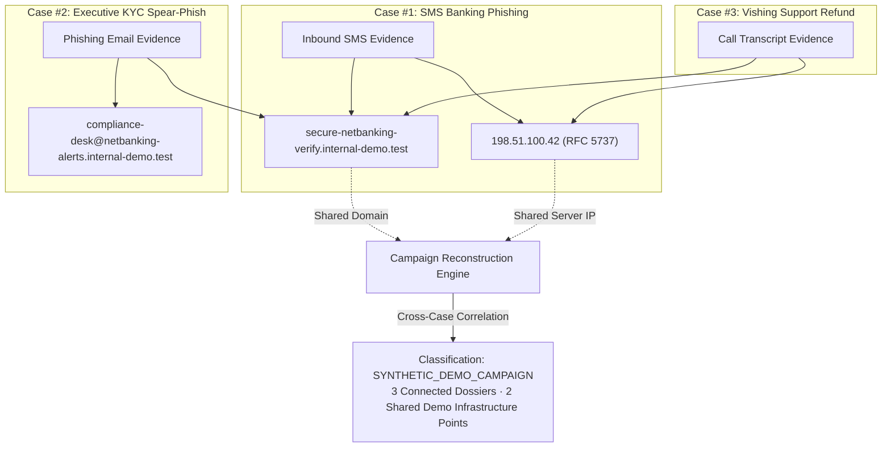
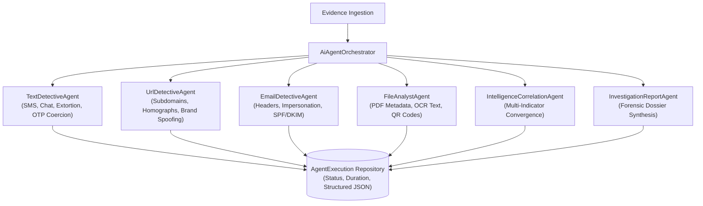
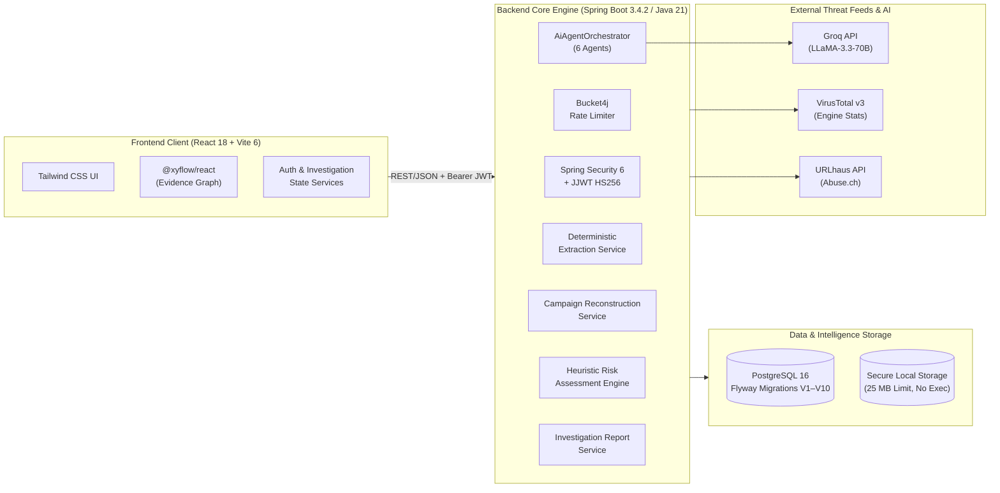

# PhantomTrace

> **Investigate entire scam campaigns — not just individual URLs.**

[](https://www.oracle.com/java/)
[](https://spring.io/projects/spring-boot)
[](https://react.dev/)
[](https://vitejs.dev/)
[](https://www.postgresql.org/)
[](https://frontend-eta-brown-50.vercel.app)
[](https://phantomtrace-backend-vhxt.onrender.com/api/v1/health)
[]()
[]()
[](LICENSE)
[]()

> 🌐 **Live Public Deployment:**
> - **Frontend Application (Vercel):** [https://frontend-eta-brown-50.vercel.app](https://frontend-eta-brown-50.vercel.app)
> - **Backend REST API (Render):** [https://phantomtrace-backend-vhxt.onrender.com](https://phantomtrace-backend-vhxt.onrender.com)
> - **Live Health Diagnostic:** [`https://phantomtrace-backend-vhxt.onrender.com/api/v1/health`](https://phantomtrace-backend-vhxt.onrender.com/api/v1/health)

---

## Table of Contents

1. [Problem Statement](#problem-statement)
2. [Solution & Core Value Proposition](#solution--core-value-proposition)
3. [Why PhantomTrace is Different](#why-phantomtrace-is-different)
4. [Signature Feature: Cross-Investigation Campaign Reconstruction](#signature-feature-cross-investigation-campaign-reconstruction)
5. [Epistemic Truth Standards](#epistemic-truth-standards)
6. [Six Specialized Forensic AI Agents](#six-specialized-forensic-ai-agents)
7. [System Architecture](#system-architecture)
8. [Interactive Evidence Relationship Graph](#interactive-evidence-relationship-graph)
9. [Transparent Risk Assessment Engine](#transparent-risk-assessment-engine)
10. [Synthetic Demo Dataset System](#synthetic-demo-dataset-system)
11. [Forensic Reporting & Chain of Custody](#forensic-reporting--chain-of-custody)
12. [Complete REST API Reference](#complete-rest-api-reference)
13. [Technology Stack](#technology-stack)
14. [Installation & Setup](#installation--setup)
15. [Configuration & Environment Variables](#configuration--environment-variables)
16. [Verification & Automated Test Results](#verification--automated-test-results)
17. [Security Considerations](#security-considerations)
18. [Honest System Limitations](#honest-system-limitations)
19. [Kiro Development Workflow](#kiro-development-workflow)
20. [Pre-Existing Code Disclosure & License](#pre-existing-code-disclosure--license)

---

## Problem Statement

Modern social-engineering attacks are **fragmented by design**. A threat actor initiates an attack via an SMS notification, directs the victim to a credential-harvesting landing page, follows up with an urgent spoofed corporate email, and sends an OTP or payment lure via a voice call (vishing). Each piece of evidence arrives through a different communication channel at a different time.

Existing tools (VirusTotal, URLhaus, free link scanners) analyze each artifact **in complete isolation**:
- They answer: *"Is this specific URL currently listed on a blocklist?"*
- They **cannot** answer: *"Are these three separate messages part of the same coordinated threat campaign targeting my organization?"*

Security analysts, fraud responders, and individuals lack a unified platform that connects disparate evidence into a forensic case dossier, reconstructs cross-case infrastructure relationships, and maintains strict epistemic separation between hard cryptographic facts and generative AI hypotheses.

---

## Solution & Core Value Proposition

**PhantomTrace** is an enterprise-grade, AI-assisted digital threat forensic investigation platform. It enables investigators to:

1. **Ingest Multi-Channel Evidence** — Securely store SMS alerts, emails (with headers), raw URLs, documents (PDF), and images (screenshots, QR codes) within an isolated investigation dossier.
2. **Deterministic Extraction First** — Extract indicators (URLs, domains, IPs, emails, phone numbers, urgency phrases, payment terms, OTP tokens) using strict RFC-compliant regex parsers without relying on non-deterministic LLMs.
3. **External Threat Verification** — Cross-reference extracted indicators against live VirusTotal v3 and Abuse.ch URLhaus feeds with persistent database caching and explicit unavailability handling.
4. **Multi-Agent Forensic Reasoning** — Coordinate six specialized AI agents powered by Groq (LLaMA-3.3-70B) that produce structured JSON findings tagged with confidence scores and evidence references.
5. **Reconstruct Attack Campaigns** — Uncover shared infrastructure across multiple independent investigations to prove campaign-level threat actor activity.
6. **Transparent Heuristic Risk Scoring** — Calculate 0–100 risk scores with granular signal weights and independent confidence tracking.
7. **Forensic Chain of Custody Reporting** — Generate immutable case snapshots with epistemic badges (`VERIFIED`, `AI_INFERENCE`, `UNKNOWN`) ready for print or PDF export.

---

## Why PhantomTrace is Different

| Dimension | Traditional Threat Scanners | PhantomTrace Forensic Platform |
|---|---|---|
| **Investigation Scope** | Single URL or single file at a time | Entire multi-artifact case dossier + cross-investigation campaigns |
| **Epistemic Truth Standard** | Binary clean/malicious label (often misleading) | Explicit tripartite labels: `VERIFIED`, `AI_INFERENCE`, `UNKNOWN` |
| **Campaign Reconstruction** | Not supported — each scan is stateless | Links shared domains, IPs, URLs, and identities across multiple cases |
| **Noise Filtering** | None — matches any common string | Dedicated generic domain filter (e.g. `google.com`, `bit.ly`) prevents false associations |
| **Attribution Honesty** | Claims "malicious campaign" from single hits | Classifies into `ISOLATED_INCIDENT`, `POSSIBLE`, `PROBABLE`, and `CONFIRMED` |
| **AI Role** | Unstructured conversational chatbot | 6 specialized agents with typed JSON schemas and failure isolation |
| **Risk Transparency** | Opaque proprietary risk score | Transparent itemized weights (e.g. Verified Threat +40, OTP Theft +25) |
| **Audit & Compliance** | Ephemeral browser results | Immutable persisted report snapshots with formal Chain of Custody |

---

## Signature Feature: Cross-Investigation Campaign Reconstruction

The primary differentiator of PhantomTrace is its ability to **reconstruct scam campaigns across multiple separate investigations**. Threat actors frequently reuse infrastructure (phishing domains, drop servers, command-and-control IPs, sender addresses) across different victims and channels.



### Campaign Reconstruction Engine Mechanics
1. **Tenant-Safe Indicator Indexing:** Queries all indicators owned by the authenticated tenant (`findByEvidenceInvestigationUserId`) to uncover cross-case links while maintaining strict multi-tenant isolation.
2. **Generic Benign Domain Noise Filter:** Automatically filters common platforms (`google.com`, `gmail.com`, `yahoo.com`, `outlook.com`, `microsoft.com`, `apple.com`, `bit.ly`, `tinyurl.com`, `t.co`, `facebook.com`, `twitter.com`, `linkedin.com`) to prevent false campaign associations.
3. **Five-Tier Explainable Classification Standard:**
   - **`ISOLATED_INCIDENT`**: No shared infrastructure across evidence items or dossiers.
   - **`POSSIBLE`**: Single indicator overlap or heuristic correlation observed across artifacts.
   - **`PROBABLE`**: Multiple distinct infrastructure indicators (e.g. domain, IP, sender identity) converge across independent investigations.
   - **`CONFIRMED`**: Real-world shared infrastructure verified as malicious by authoritative external threat intelligence feeds (e.g., active VirusTotal / URLhaus malicious listing).
   - **`SYNTHETIC_DEMO_CAMPAIGN`**: Dedicated classification for demonstration test fixtures (RFC 2606 `.test` domains and RFC 5737 TEST-NET IPs like `198.51.100.42`). Synthetic fixtures **never** produce a real-world `CONFIRMED` campaign, maintaining 100% forensic defensibility.
4. **Forensic Attribution Narrative:** Generates automated, human-readable explanations detailing exactly which infrastructure indicators connect the dossiers, how many cases are linked, and the chronological timeline.
5. **Synthetic-to-Genuine Contamination Prevention:** Genuine investigations are strictly partitioned from synthetic demo test fixtures. If a genuine case shares an indicator with a synthetic demo case, the synthetic dossier is quarantined (`linkConfidence: SYNTHETIC_DEMO`), an explicit `SYNTHETIC_DEMO_ISOLATION` signal is recorded, and genuine attribution requires $\ge 2$ independent real-world indicators. Synthetic fixtures can never elevate, downgrade, or contaminate a genuine forensic classification.
6. **RFC Standards Compliance & Threat Feed Safeguards:**
   - Detects all RFC 5737 TEST-NET ranges (`192.0.2.0/24`, `198.51.100.0/24`, `203.0.113.0/24`) and RFC 2606 / 6761 test TLDs (`.test`, `.invalid`, `.localhost`, `.example`), returning `UNKNOWN` with an explicit `SYNTHETIC_TEST_INDICATOR` reason without consuming external VirusTotal/URLhaus API quotas.
   - RFC 2606 reserved documentation domains (`example.com`, `example.net`, `example.org`) are distinguished from test fixtures, ensuring threat intelligence lookups proceed normally in genuine investigations while strictly rejecting non-RFC domains like `example.edu`.

---

## Epistemic Truth Standards

In accordance with strict cybersecurity forensic practices, PhantomTrace enforces the **Epistemic Truth Principle**:

- **`VERIFIED` (Green):** Facts established via deterministic processing:
  - Cryptographic hashes (SHA-256) of uploaded files
  - Deterministic regex extractions of URLs, emails, phone numbers, and IPs
  - Confirmed positive responses from external threat feeds (VirusTotal / URLhaus)
- **`AI_INFERENCE` (Amber/Yellow):** Analytical hypotheses generated by Groq LLM agents:
  - Deception intent and social engineering urgency scores
  - Suspected corporate impersonation targets
  - Behavioral risk contributions and recommended remediation actions
- **`UNKNOWN` (Slate):** Unchecked, rate-limited, or unresolvable dimensions:
  - Missing threat intelligence lookups when API keys are unconfigured
  - Unresolvable DNS or private IP addresses
  - Unavailable external services — **never** represented as clean or safe

---

## Six Specialized Forensic AI Agents

PhantomTrace orchestrates six specialized AI agents powered by Groq (`llama-3.3-70b-versatile`) with structured JSON schema enforcement and per-agent failure isolation:



1. **`TextDetectiveAgent`**: Detects psychological manipulation, urgency triggers, false authority lures, and credential/OTP requests in SMS and instant messaging transcripts.
2. **`UrlDetectiveAgent`**: Inspects URI schemes, deceptive subdomains, typo-squatting, homoglyph variations, brand spoofing paths, and suspicious TLD patterns.
3. **`EmailDetectiveAgent`**: Analyzes sender addresses, display name spoofing, corporate impersonation tactics, and header inconsistencies.
4. **`FileAnalystAgent`**: Evaluates document structures, embedded JavaScript markers in PDFs (via Apache PDFBox), OCR text extracts (via Tess4J), and QR code payloads (via ZXing).
5. **`IntelligenceCorrelationAgent`**: Correlates multiple extracted indicators within an evidence artifact, detecting multi-vector attack patterns.
6. **`InvestigationReportAgent`**: Synthesizes all agent outputs and deterministic findings into an executive summary, chronological incident timeline, and prioritized containment checklist.

---

## System Architecture



---

## Interactive Evidence Relationship Graph

The evidence relationship graph provides visual clarity using **`@xyflow/react`** (React Flow):

- **Hierarchical DAG Layout:** Organizes nodes hierarchically to prevent overlapping:
  $$\text{Investigation Dossier} \longrightarrow \text{Evidence Artifacts} \longrightarrow \text{Extracted Indicators}$$
- **Semantic Edge Color-Coding:**
  - 🔴 **Rose (`#f43f5e`):** `MATCHES_THREAT_INDICATOR` — Confirmed threat intelligence hit (pulsing animation)
  - 🟣 **Purple (`#a855f7`):** `SHARES_INDICATOR` — Shared cross-case campaign infrastructure
  - 🔵 **Cyan (`#06b6d4`):** `REFERENCES_DOMAIN` / `CONTAINS_URL` — Target destination links
  - 🟪 **Violet (`#8b5cf6`):** `MENTIONS_EMAIL` — Communication identifiers
- **Interactive Provenance Sidebar:** Clicking any node or relationship reveals its underlying verification status, confidence percentage, extraction engine, and source evidence ID.

---

## Transparent Risk Assessment Engine

PhantomTrace rejects opaque "black box" risk scores. The overall score (0–100) is calculated as a transparent, weighted aggregation of discrete, explainable risk contributions:

$$\text{Risk Score} = \min\left(100, \sum_{i} w_i \cdot \text{signal}_i\right)$$

> [!IMPORTANT]
> **Risk Scores Are Not Probabilities:** The composite risk score (0–100) represents a deterministic, weighted heuristic aggregation of discrete forensic signals and analytical flags. It is **not** a Bayesian or statistical probability of compromise (e.g., a score of 75 signifies cumulative convergence across multiple high-severity signals, not a 75% mathematical likelihood of an attack).

| Risk Signal | Base Weight | Epistemic Basis | Trigger Condition |
|---|:---:|:---:|---|
| **Verified Malicious Intel** | **+40** | `VERIFIED` | VirusTotal $\ge 5$ positives or URLhaus listed active malicious |
| **Credential / OTP Theft** | **+25** | `VERIFIED` / `AI_INFERENCE` | Explicit solicitation of passwords, PINs, or one-time passcodes |
| **Payment / Wire / Advance Fee** | **+20** | `VERIFIED` / `AI_INFERENCE` | Request for wire transfer, cryptocurrency, gift cards, or refunds |
| **Impersonation / Spoofing** | **+15** | `AI_INFERENCE` | Display name mismatch or brand masquerading |
| **Urgency & Coercion Pressure** | **+10** | `DETERMINISTIC` | Deadlines (e.g. "within 24 hours", "immediate account suspension") |
| **Unusual URL / Path Obfuscation** | **+10** | `DETERMINISTIC` | IP in URL, suspicious TLD, high sub-domain depth, URL shortener |

### Risk Severities:
- **`LOW` (0–19):** Informational or benign characteristics.
- **`MODERATE` (20–39):** Isolated risk indicators such as payment requests or urgency language.
- **`HIGH` (40–69):** Multi-signal convergence combining credentials, impersonation, and urgency lures.
- **`CRITICAL` (70–100):** Confirmed external malicious threat intelligence or cumulative critical threat vectors.
- **`INCONCLUSIVE`:** Insufficient evidence or no deterministic indicators extracted (evaluated independently of score).

---

## Synthetic Demo Dataset System

To enable reliable, zero-configuration demonstrations during hackathon evaluations without requiring live malicious URLs or risky threat feeds, PhantomTrace includes a built-in **Synthetic Demo Dataset Engine**:

- **One-Click Seeding (`POST /api/v1/demo/seed`):** Generates the **"Apex Banking Fraud Campaign"** consisting of 3 interconnected cases:
  1. `[DEMO] Apex Campaign — SMS Banking Alert & Account Suspension` (Urgent SMS lure)
  2. `[DEMO] Apex Campaign — Spear-Phishing Email & KYC Lure` (Corporate email phish)
  3. `[DEMO] Apex Campaign — Vishing Follow-up & Fraud Refund Lure` (Voice transcript refund lure)
- **Shared Synthetic Infrastructure:** All 3 cases converge on the domain `secure-netbanking-verify.internal-demo.test` and server IP `198.51.100.42` (RFC 5737 TEST-NET-2).
- **Absolute Rule B Compliance:** All demo cases are prominently prefixed with `[DEMO]` and classified as `SYNTHETIC_DEMO_CAMPAIGN` with `SYNTHETIC DEMO` badges to ensure judges never mistake synthetic test fixtures for live production incidents. Synthetic fixtures receive zero real-world threat intelligence points.
- **Persistent Provenance & Tenant Isolation (`V10__add_synthetic_demo_to_investigations.sql`):** Investigations track persistent `synthetic_demo` provenance at the database level with a compound index `(user_id, synthetic_demo)`. This guarantees synthetic demo artifacts can never be mixed with genuine casework.
- **Idempotent Reset (`DELETE /api/v1/demo/reset`):** Safely cleans up demo dossiers strictly scoped to the authenticated user and `syntheticDemo = true`, ensuring genuine user investigations are never affected or deleted.

---

## Forensic Reporting & Chain of Custody

The **Investigation Report Service** produces immutable case snapshots designed for compliance audits, law enforcement referrals, or executive briefings:

1. **Executive Dossier:** Case metadata, severity classification, and composite risk metrics.
2. **Attribution Summary:** Campaign reconstruction narrative with connected cross-case links.
3. **Structured Findings Catalog:** Every finding includes confidence score, evidence source reference, and recommended remediation.
4. **Epistemic Standards Key:** Explicitly differentiates between hard deterministic facts and AI inferences.
5. **Chain of Custody & Legal Sign-Off:** Formatted block documenting analyst identity, timestamp, SHA-256 verification, and formal sign-off lines.
6. **Print & PDF Optimization:** Custom `@media print` CSS formats the dossier into a crisp forensic document via browser print (`Cmd/Ctrl + P`).

---

## Complete REST API Reference

- **Production Base URL:** `https://phantomtrace-backend-vhxt.onrender.com/api/v1`
- **Local Base URL:** `http://localhost:8080/api/v1`

All application endpoints are versioned under `/api/v1` and return standard JSON wrappers:

```json
{
  "success": true,
  "message": "Operation completed successfully",
  "data": { ... }
}
```

### 1. Authentication (`/api/v1/auth`)
- `POST /api/v1/auth/register` — Create user account (`email`, `password`, `fullName`)
- `POST /api/v1/auth/login` — Authenticate and receive 24-hour HS256 JWT

### 2. Investigation Dossiers (`/api/v1/investigations`)
- `GET /api/v1/investigations` — List user's investigations
- `POST /api/v1/investigations` — Create new dossier (`title`, `description`, `category`)
- `GET /api/v1/investigations/{id}` — Retrieve dossier details
- `PUT /api/v1/investigations/{id}` — Update title, description, category, or status
- `DELETE /api/v1/investigations/{id}` — Delete dossier (cascades to evidence and reports)

### 3. Evidence Management (`/api/v1/investigations/{id}/evidence` & `/api/v1/evidence`)
- `POST /api/v1/investigations/{id}/evidence/text` — Ingest text message, email, or URL evidence
- `POST /api/v1/investigations/{id}/evidence/file` — Ingest PDF, image, or document (multipart/form-data)
- `GET /api/v1/evidence/{evidenceId}` — Get evidence metadata
- `DELETE /api/v1/evidence/{evidenceId}` — Remove evidence artifact

### 4. Deterministic Extraction & Threat Intelligence (`/api/v1/evidence/{id}`)
- `GET /api/v1/evidence/{evidenceId}/indicators` — List extracted URLs, domains, IPs, emails, terms
- `POST /api/v1/evidence/{evidenceId}/threat-lookups` — Trigger live VirusTotal & URLhaus queries
- `GET /api/v1/evidence/{evidenceId}/threat-lookups` — Retrieve cached threat intelligence results

### 5. Multi-Agent AI Analysis (`/api/v1/evidence/{id}/analysis`)
- `POST /api/v1/evidence/{evidenceId}/analysis` — Run orchestrated AI forensic detective agents
- `GET /api/v1/evidence/{evidenceId}/analysis` — Retrieve past agent execution logs and JSON outputs

### 6. Evidence Graph & Campaign Reconstruction
- `GET /api/v1/investigations/{id}/graph` — Retrieve React Flow nodes and typed relationship edges
- `GET /api/v1/investigations/{id}/campaign` — Execute cross-investigation campaign reconstruction

### 7. Synthetic Demo Dataset (`/api/v1/demo`)
- `POST /api/v1/demo/seed` — Seed 3-case interconnected Apex Banking Fraud campaign
- `DELETE /api/v1/demo/reset` — Remove demo cases belonging to authenticated user (strictly scoped to `syntheticDemo = true`)
- `GET /api/v1/demo/status` — Check whether demo campaign is currently active

### 8. Forensic Reports (`/api/v1/investigations/{id}/reports`)
- `POST /api/v1/investigations/{id}/reports` — Compile and persist an immutable forensic snapshot
- `GET /api/v1/investigations/{id}/reports` — List past generated reports for dossier
- `GET /api/v1/investigations/reports/{reportId}` — Retrieve specific report JSON

### 9. System Health (`/api/v1/health`)
- `GET /api/v1/health` — Service health check (`status: UP`, application name)

---

## Technology Stack

```
Frontend:
├── Framework: React 18 (SPA)
├── Bundler & Dev Server: Vite 6
├── Routing: React Router v6
├── Styling: Tailwind CSS 3 with Custom Cybersecurity Dark Theme
├── Graph Visualization: @xyflow/react (React Flow)
├── Charts: Recharts
├── Icons: Lucide React
└── Unit Testing: Vitest + @testing-library/react + jsdom

Backend:
├── Runtime: Java 21 (LTS) / Java 23 compatible
├── Framework: Spring Boot 3.4.2
├── Security: Spring Security 6 + JJWT 0.12.6 (HS256)
├── Database Access: Spring Data JPA + Hibernate ORM
├── Migrations: Flyway (V1–V10, including V10 persistent synthetic_demo schema)
├── Rate Limiting: Bucket4j
├── Forensics: Apache PDFBox 3.0.4, ZXing 3.5.3, Tess4J 5.13.0
└── Unit Testing: JUnit 5, Mockito, Spring MockRestServiceServer

Database & Infrastructure:
├── Database: PostgreSQL 16
└── Containerization: Docker & Docker Compose
```

---

## Installation & Setup

### Live Hosted Deployment
The platform is deployed and fully operational for evaluation without local configuration:
- **Web Application (Vercel):** [https://frontend-eta-brown-50.vercel.app](https://frontend-eta-brown-50.vercel.app)
- **Backend API (Render):** [https://phantomtrace-backend-vhxt.onrender.com](https://phantomtrace-backend-vhxt.onrender.com)
- **Health Check:** [`https://phantomtrace-backend-vhxt.onrender.com/api/v1/health`](https://phantomtrace-backend-vhxt.onrender.com/api/v1/health)

### Local Development Prerequisites
- **Node.js** v20+ & **npm** v10+
- **Java** 21+ (JDK)
- **Maven** 3.9+
- **Docker** & Docker Compose (optional for local PostgreSQL)

### 1. Clone the Repository
```bash
git clone https://github.com/samir-0-4/ScamShield.git phantomtrace
cd phantomtrace
```

### 2. Configure Environment Files
```bash
cp .env.example .env
cp backend/.env.example backend/.env
cp frontend/.env.example frontend/.env
```

### 3. Start PostgreSQL Database
```bash
docker compose up -d postgres
```
*Verify database status:*
```bash
docker compose ps
```

### 4. Start the Backend Service
```bash
cd backend
mvn spring-boot:run
```
The backend initializes on `http://localhost:8080`. Flyway automatically executes database migrations V1 through V10 (including `V10__add_synthetic_demo_to_investigations.sql` for persistent synthetic demo isolation).

*Verify health check:*
```bash
curl http://localhost:8080/api/v1/health
# {"success":true,"message":"PhantomTrace API is operational","data":{"status":"UP","application":"PhantomTrace"}}
```

### 5. Start the Frontend Application
```bash
cd ../frontend
npm install
npm run dev
```
Open `http://localhost:5173` in your browser.

---

## Configuration & Environment Variables

### Backend Configuration (`backend/.env`)

| Variable | Required | Default / Example | Purpose |
|---|:---:|---|---|
| `POSTGRES_DB` | ✅ | `phantomtrace` | PostgreSQL database name |
| `POSTGRES_USER` | ✅ | `phantomtrace_user` | Database user |
| `POSTGRES_PASSWORD` | ✅ | *(secure password)* | Database password |
| `DATABASE_URL` | ✅ | `jdbc:postgresql://localhost:5432/phantomtrace` | JDBC connection string |
| `JWT_SECRET` | ✅ | `openssl rand -base64 32` | HS256 secret key ($\ge 256$ bits) |
| `JWT_EXPIRATION_MS` | — | `86400000` (24h) | Token lifespan in milliseconds |
| `GROQ_API_KEY` | ⚠️ | `gsk_...` | Groq API key for AI agent analysis |
| `GROQ_DEFAULT_MODEL` | — | `llama-3.3-70b-versatile` | Groq model identifier |
| `VIRUSTOTAL_API_KEY` | ⚠️ | `...` | VirusTotal v3 API key |
| `URLHAUS_API_KEY` | ⚠️ | `...` | Abuse.ch URLhaus API key |
| `FILE_STORAGE_TYPE` | — | `local` | Storage mode (`local`) |
| `FILE_STORAGE_UPLOAD_DIR` | — | `./uploads` | Uploaded evidence storage directory |

> [!NOTE]
> `GROQ_API_KEY`, `VIRUSTOTAL_API_KEY`, and `URLHAUS_API_KEY` are **optional**. When unconfigured, the application functions cleanly using deterministic extraction and heuristic risk scoring, explicitly marking threat lookups as `UNKNOWN` (never falsely claiming they are clean).

### Frontend Configuration (`frontend/.env`)

| Variable | Required | Default | Purpose |
|---|:---:|---|---|
| `VITE_API_BASE_URL` | ✅ | `http://localhost:8080/api/v1` | Root URL of backend REST API |

---

## Verification & Automated Test Results

All test suites and production builds have been verified directly in the environment:

```bash
# Run backend tests
cd backend && mvn test

# Run frontend tests, linting, and build
cd frontend && npm test -- --run && npm run lint && npm run build
```

### Exact Verified Metrics

| Test Suite | Total Tests | Passed | Failed | Errors | Skipped | Status |
|---|:---:|:---:|:---:|:---:|:---:|:---:|
| **Backend Suite (JUnit 5 + Mockito)** | **191** | **191** | **0** | **0** | **0** | ✅ **PASSING** |
| **Frontend Suite (Vitest + RTL)** | **32** | **32** | **0** | **0** | **0** | ✅ **PASSING** |
| **Frontend ESLint Check** | Codebase | Clean | **0** | **0** | — | ✅ **0 ERRORS / 0 WARNS** |
| **Frontend Production Build (Vite)** | 1,727 modules | Clean | **0** | **0** | — | ✅ **BUILT IN ~1.6s** |

> [!NOTE]
> **Automated Test Isolation & Live Threat Feed Feasibility:** The 191 automated backend tests verify integration contracts, JSON schemas, threat mapping, and rate limiting using Mockito and Spring's `MockRestServiceServer`. In accordance with forensic testing integrity, automated tests do not claim live external VirusTotal or URLhaus verification based on mocked test executions. Live threat intelligence queries are executed in runtime environments when API keys are configured.

---

## Security Considerations

- **Server-Side Request Forgery (SSRF) Protection:** The backend server never fetches arbitrary or untrusted URLs extracted from evidence. Outbound requests are strictly restricted to whitelisted external APIs (Groq, VirusTotal, URLhaus).
- **No File Execution:** Uploaded files (PDFs, images) are inspected solely via memory-safe parsers (PDFBox, ZXing, Tess4J). Uploaded binaries are never executed.
- **Strict Multi-Tenant Isolation (IDOR Prevention):** All queries enforce database-level or service-level tenant checks (`currentUserId`). Cross-investigation campaign queries are strictly constrained to the authenticated tenant.
- **Rate Limiting:** In-memory Bucket4j token bucket limits registration, authentication, evidence ingestion, and external lookups per client IP address.
- **Cryptographic Authentication:** Passwords hashed with bcrypt; JWT tokens signed with HS256 enforcing minimum 256-bit entropy.
- **SQL Injection Prevention:** 100% parameterized queries via Spring Data JPA and Hibernate ORM.
- **Pre-Commit Secret Scanning:** Checked-in git hook (`.kiro/hooks/pre-commit-check.sh`) prevents accidental commit of `.env` files.

---

## Honest System Limitations

To preserve technical credibility under adversarial forensic scrutiny:

1. **OCR Quality Dependencies:** Tess4J relies on image resolution and contrast. Low-resolution or heavily distorted screenshots can produce partial OCR extractions.
2. **AI Inference Boundaries:** Findings generated by Groq LLM agents are explicitly marked `AI_INFERENCE`. They represent probabilistic analytical hypotheses and are never described as verified forensic facts. Epistemic badges (`VERIFIED`, `AI_INFERENCE`, `UNKNOWN`) strictly separate deterministic cryptographic and regex extractions from generative LLM reasoning. Furthermore, composite risk scores are explainable heuristic aggregations, not statistical probabilities.
3. **External Threat Feed Quotas:** Live queries to VirusTotal and URLhaus are subject to external API rate limits. When limits are exceeded, indicators gracefully fall back to local heuristic analysis.
4. **No Raw WHOIS / RDAP Queries:** Domain age, registrant names, and ASN details are not queried via raw sockets to maintain server isolation.
5. **Local Storage Default:** File uploads default to local filesystem storage (`./uploads`). Production deployments should configure S3-compatible object storage.
6. **IPv6 Indicator Extraction Pipeline:** The deterministic extraction pipeline (`DeterministicExtractionService`) currently targets IPv4 addresses (`IP_ADDRESS`). IPv6 indicators—including documentation ranges such as RFC 3849 (`2001:db8::/32`)—are not parsed by the regular expression pipeline. Synthetic indicator detection for RFC 5737 TEST-NET ranges strictly targets IPv4.

---

## Kiro Development Workflow

PhantomTrace was architected, implemented, and verified using **[Kiro IDE](https://kiro.dev)** during the November 2026 development window. The repository preserves complete durable artifacts under `.kiro/`:

### 1. Steering Rules (`.kiro/steering/`)
- `project-rules.md` — Enforces the Epistemic Truth Principle, architecture boundaries, and secret protection.
- `architecture.md` — Complete structural blueprints.
- `tech-stack.md` — Canonical version pinnings for Java 21, Spring Boot 3.4.2, and React 18.
- `security.md` — SSRF, IDOR, and tenant isolation constraints.
- `coding-standards.md` — DTO patterns and transactional standards.
- `testing.md` — Mandated test suites and verification workflows.

### 2. Feature Specifications (`.kiro/specs/`)
Every major subsystem was developed following Kiro specifications (`requirements.md`, `design.md`, `tasks.md`):
- `campaign-reconstruction` — Cross-investigation engine, noise filtering, and attribution classifications.
- `evidence-relationship-graph` — React Flow DAG, semantic colors, and node detail panel.
- `deterministic-evidence-extraction` — RFC-compliant extraction rules.
- `threat-intelligence-integration` — VirusTotal v3 and URLhaus integration.
- `ai-analysis-agents` — Six Groq agents with structured JSON outputs.
- `risk-assessment` — Heuristic scoring and signal contributions.
- `investigation-reports` — Persistent dossier generation and print export.
- `auth-foundation` & `backend-foundation` — Security and data layer foundation.

### 3. Hooks & Custom Agents (`.kiro/hooks/` & `.kiro/agents/`)
- `.kiro/hooks/pre-commit-check.sh` — Blocks commits containing staged `.env` files.
- `.kiro/hooks/backend-test.sh` — Runs backend test suites.
- `.kiro/hooks/frontend-lint-build.sh` — Runs ESLint and Vite build validations.
- `.kiro/agents/threat-analyst.md` — Specialized threat analyst persona for forensic indicator validation.

---

## Pre-Existing Code Disclosure & License

**All code in this repository was written between November 10–14, 2026.**

No proprietary, closed-source, or pre-existing third-party codebase was used. All libraries and tools are open-source and declared in `frontend/package.json` and `backend/pom.xml`.

### License
This project is licensed under the **Apache License 2.0**. See the [LICENSE](LICENSE) file for details.

Copyright © 2026 PhantomTrace Contributors
