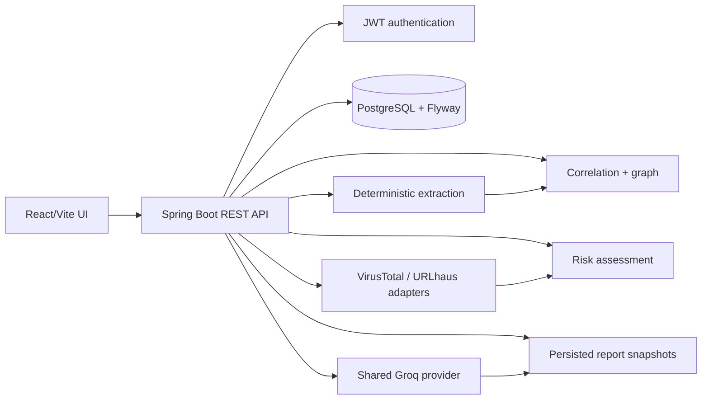

# Hackathon Final Delivery

## Product overview

PhantomTrace (shown as ScamShield in the product narrative) turns messages,
emails, URLs, and private files into a traceable investigation. It combines
deterministic extraction, optional external intelligence, shared-provider AI
agents, deterministic correlation, transparent risk scoring, an interactive
graph, and printable reports.

## Problem and solution

Scam evidence is fragmented across messages, links, email fields, and files.
PhantomTrace keeps those artifacts in one investigation, extracts indicators
without requiring an LLM, connects only relationships supported by evidence, and
labels uncertainty instead of presenting guesses as facts.

## Architecture

## Technology stack

React 18, Vite, Tailwind CSS, Axios, React Router, React Flow, Lucide, Recharts;
Spring Boot 3.4, Java 21 target, Spring Security JWT, Spring Data JPA, Flyway,
PostgreSQL 16, Groq OpenAI-compatible API, VirusTotal, and URLhaus.

## AI agent architecture

Text, URL, email, correlation, file, and report agents share one provider
configuration. Structured JSON is validated before persistence. User evidence is
treated as untrusted input; agents cannot execute tools, shell, SQL, or arbitrary
URLs. AI results are separate from deterministic extraction and are labelled as
inference where appropriate.

## Evidence correlation

The correlation orchestrator normalizes indicators, creates investigation-scoped
threat indicator records, and persists provenance-bearing relationships such as
`CONTAINS_URL`, `REFERENCES_DOMAIN`, `MENTIONS_EMAIL`, and `SHARES_INDICATOR`.
The React Flow view is a projection of this API; it adds no hardcoded entities.

## Database architecture

Flyway migrations V1–V9 create users, investigations, evidence, extracted
indicators, threat lookups, agent executions, correlation data, risk assessments,
and report snapshots. PostgreSQL stores metadata and structured outputs; private
uploaded files use the configured storage abstraction.

## Security approach

JWT ownership checks protect investigations, evidence, graph, risk, and reports.
Files use generated storage identifiers and private storage. MIME, size, and
signature validation prevent unsafe uploads. Secrets remain backend-only.
Uploaded files are never executed, and arbitrary user URLs are never fetched.

## Limitations and future scope

QR decoding is not implemented as an analysis pipeline. Groq, VirusTotal, and
URLhaus require credentials and can be unavailable or rate-limited. Local
storage is suitable for development, not horizontally scaled production.
Future work includes durable object storage, background job processing, stronger
audit trails, QR decoding, report versioning, and production observability.

The reproducible live demo is preferred. A presentation-only fallback fixture is
available at [demo-fallback.json](demo-fallback.json) and is explicitly not
connected to the frontend or backend.

## Kiro usage evidence

The repository contains one steering document, reviewed feature specs with
requirements/design/tasks, a pre-commit hook definition, and the threat-analyst
custom agent definition. The project claims only these checked-in artifacts and
does not claim undocumented hook or agent execution.
